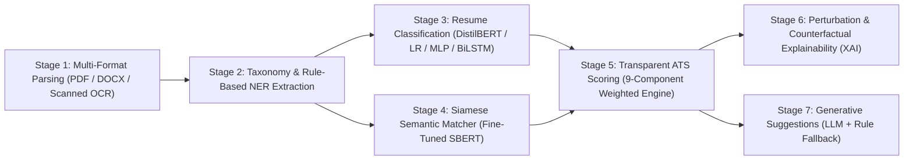

# AI-Powered Resume Screening & Job Fit Analytics Platform

An end-to-end, privacy-preserving deep learning pipeline and interactive dashboard for resume parsing, skill extraction, industry classification, semantic job matching, transparent ATS scoring, perturbation-based explainability, and targeted suggestions.

---

## Architecture Overview



The system executes a strictly sequential 7-stage pipeline orchestrated by `app.pipeline.run_pipeline`:
1. **Multi-Format Parsing (`app.parsing`)**: Extracts raw text, detects document structure (multi-column, tables, scanned images), and extracts contact info using pdfplumber, python-docx, and Tesseract OCR fallback.
2. **Entity & Skill Extraction (`app.extraction`)**: Maps skills against a curated 2,800+ skill taxonomy with longest-match-first token scanning and 19 ambiguous term disambiguation rules. Extracts education and date-normalized experience spans.
3. **Resume Classification (`app.classifier`)**: Classifies candidate resumes into 24 industry categories using fine-tuned DistilBERT (or fast TF-IDF Logistic Regression fallback).
4. **Semantic Resume-JD Matching (`app.matcher`)**: Encodes resumes and job descriptions into dense embeddings via fine-tuned Siamese SBERT (`sentence-transformers/all-MiniLM-L6-v2` trained with MultipleNegativesRankingLoss).
5. **Transparent ATS Scoring (`app.scoring`)**: Computes a deterministic 0–100 score across 9 weighted dimensions: Semantic Match (25%), Keyword Coverage (20%), Section Completeness (10%), Experience Fit (10%), Formatting (10%), Quantified Achievements (10%), Action Verbs (5%), Readability (5%), and Contact Info (5%).
6. **Counterfactual Explainability (`app.explainability`)**: Runs LIME-style feature attribution, keyword masking, and category-level counterfactual suggestions without black-box opacity.
7. **Targeted Suggestions (`app.suggestions`)**: Generates actionable, ATS-improving suggestions using Google Gemini / Anthropic / OpenAI APIs when configured, falling back seamlessly to deterministic rule-based advice offline.

---

## Syllabus Unit Mapping

| Deep Learning Curriculum Unit | Implemented System Modules | Technical Concepts & Artifacts |
| :--- | :--- | :--- |
| **Unit I: Foundations of Neural Networks** | `app/classifier/tfidf_mlp.py`, `app/classifier/tfidf_lr.py` | Feedforward neural architectures, cross-entropy loss, Adam optimization, regularization, learning curves, train-val-test splitting. |
| **Unit II: Deep Representations & Metric Learning** | `app/matcher/`, `app/explainability/` | Siamese networks, cosine similarity spaces, MultipleNegativesRankingLoss (MNRL), contrastive representations, perturbation-based feature attribution. |
| **Unit III: Recurrent Neural Architectures** | `app/classifier/bilstm.py` | Bidirectional LSTMs, sequence tokenization, padded mini-batching, out-of-vocabulary handling, hidden-state pooling, underfitting analysis. |
| **Unit IV: Transformers & Pretrained Models** | `app/classifier/distilbert.py`, `app/matcher/model.py` | Self-attention mechanisms, transfer learning, Hugging Face `transformers` fine-tuning, linear warmup learning rate schedules, subword tokenization. |
| **Unit V: Generative AI & Explainability** | `app/suggestions/`, `app/explainability/`, `app/ui/` | Prompt engineering, multi-turn LLM generation, grounded hallucination guards, counterfactual explanation, model interpretability. |

---

## Setup & Installation

### 1. Prerequisites
- Python 3.10 or 3.11 (tested on Python 3.11.15)
- macOS, Linux, or Windows WSL2
- Optional OCR Engine (for scanned image PDFs):
  - macOS: `brew install tesseract`
  - Ubuntu/Debian: `sudo apt-get install tesseract-ocr`

### 2. Virtual Environment Setup
```bash
# Clone or navigate to the repository
cd /path/to/DL_PROJECT

# Create and activate virtual environment
python3 -m venv venv
source venv/bin/activate  # On Windows: venv\Scripts\activate

# Install dependencies
pip install --upgrade pip
pip install -r requirements.txt
```

### 3. Optional LLM API Configuration
The pipeline is 100% functional locally and offline. If you wish to enable GenAI suggestions via cloud providers, configure any of the following environment variables in a `.env` file:
```bash
# Supported providers (pipeline detects whichever is set, prioritizing Gemini)
GEMINI_API_KEY=your_gemini_api_key_here
ANTHROPIC_API_KEY=your_anthropic_api_key_here
OPENAI_API_KEY=your_openai_api_key_here
```
When no API key is provided, the platform automatically activates deterministic, rule-based suggestion engines.

### 4. Offline Verification
To run strictly offline without network access to Hugging Face Hub:
```bash
export HF_HUB_OFFLINE=1
export TRANSFORMERS_OFFLINE=1
```

---

## How to Run

### Interactive Streamlit Dashboard
Launch the custom-styled dark theme analytics dashboard:
```bash
streamlit run app/ui/app.py
```
Open [http://localhost:8501](http://localhost:8501) in your browser.

### Preflight Sanity Check
Verify environment packages, hardware acceleration, taxonomy paths, model checkpoints, and offline operation:
```bash
python scripts/preflight.py
```

### Collect Metrics and Reports
Regenerate all markdown and CSV metric tables from stored evaluation files:
```bash
python scripts/collect_results.py
```

### Run Unit & Integration Test Suite
```bash
pytest
```

---

## Empirical Benchmark Results

All metrics below are drawn directly from saved artifacts in `artifacts/metrics/` and aggregated via `scripts/collect_results.py`.

### 1. Classifier Model Comparison (24 Classes)
Evaluated on 2,483 stratified resumes (Train: 1,739, Val: 370, Test: 374).

| Architecture | Train Acc | Train Macro F1 | Val Acc | Val Macro F1 | Test Acc | Test Macro F1 | Gen Gap (F1) |
| :--- | :---: | :---: | :---: | :---: | :---: | :---: | :---: |
| **TF-IDF + Logistic Regression** | 99.02% | 0.9882 | 64.05% | 0.5913 | 66.31% | 0.5959 | 0.3969 |
| **TF-IDF + MLP (2-layer)** | 100.00% | 1.0000 | 64.59% | 0.6001 | 65.24% | 0.6181 | 0.3999 |
| **BiLSTM + Pretrained Embeddings** | 74.30% | 0.7091 | 23.51% | 0.1860 | 25.13% | 0.1966 | 0.5231 |
| **DistilBERT (Fine-tuned, 3 epochs)** | 75.85% | 0.6748 | 65.14% | 0.5675 | 72.73% | 0.6454 | **0.1073** |

*Takeaway:* DistilBERT achieves the best generalization (72.73% test accuracy, 0.6454 test macro F1) and lowest generalization gap. Logistic Regression provides a competitive 66.31% test accuracy in under 1 second. BiLSTM severely underfits given limited training samples per category (~72 resumes/class).

### 2. Semantic Matcher Retrieval Performance (15 Categories)

| Model Architecture | Val MRR | Val nDCG@10 | Val Recall@5 | Val Recall@10 | Test MRR | Test nDCG@10 | Test Recall@5 | Test Recall@10 |
| :--- | :---: | :---: | :---: | :---: | :---: | :---: | :---: | :---: |
| **TF-IDF Baseline** | 0.6121 | 0.4537 | 0.2209 | 0.3239 | 0.6333 | 0.4854 | 0.2337 | 0.3456 |
| **Zero-Shot SBERT (all-MiniLM-L6-v2)** | 0.6377 | 0.4414 | 0.2107 | 0.3090 | 0.6311 | 0.4532 | 0.1964 | 0.3007 |
| **Fine-Tuned Siamese SBERT (MNRL)** | **0.8567** | **0.6821** | **0.3286** | **0.4671** | **0.7798** | **0.7286** | **0.3755** | **0.5338** |

### Per-Category Reciprocal Rank (MRR)
| Category | Val N | Test N | TF-IDF Val | Zero-Shot Val | Fine-Tuned Val | TF-IDF Test | Zero-Shot Test | Fine-Tuned Test |
| :--- | :---: | :---: | :---: | :---: | :---: | :---: | :---: | :---: |
| ACCOUNTANT | 17 | 18 | 0.8693 | 1.0000 | 1.0000 | 0.9008 | 0.9352 | 1.0000 |
| ADVOCATE | 17 | 18 | 0.1799 | 0.1808 | 0.7967 | 0.1696 | 0.3047 | 0.8926 |
| BANKING | 17 | 18 | 0.2214 | 0.2319 | 0.6308 | 0.4874 | 0.4869 | 0.6001 |
| BPO | 4 | 3 | 0.0333 | 0.3331 | 0.1429 | 0.0967 | 0.1241 | 0.0326 |
| BUSINESS-DEVELOPMENT | 17 | 18 | 0.6231 | 0.6814 | 0.9559 | 0.4045 | 0.1949 | 0.9630 |
| CHEF | 17 | 18 | 0.9069 | 0.9706 | 1.0000 | 0.6011 | 0.7900 | 0.7585 |
| CONSTRUCTION | 17 | 17 | 0.7420 | 0.7813 | 0.8703 | 0.8003 | 0.7739 | 0.8049 |
| CONSULTANT | 17 | 17 | 0.1282 | 0.4045 | 0.9496 | 0.0818 | 0.1779 | 0.2032 |
| DIGITAL-MEDIA | 15 | 14 | 0.7612 | 0.5835 | 0.6508 | 0.5239 | 0.5649 | 0.4648 |
| ENGINEERING | 17 | 17 | 0.5324 | 0.6816 | 0.8627 | 0.8140 | 0.8379 | 1.0000 |
| HEALTHCARE | 17 | 17 | 0.5543 | 0.5742 | 0.7095 | 0.7208 | 0.5267 | 0.8144 |
| HR | 16 | 18 | 0.7339 | 0.5947 | 0.9688 | 0.9099 | 0.7396 | 0.5926 |
| INFORMATION-TECHNOLOGY | 18 | 18 | 0.8588 | 0.6023 | 0.8421 | 0.8796 | 0.8333 | 0.9259 |
| SALES | 17 | 18 | 0.7819 | 0.8549 | 1.0000 | 0.8889 | 0.9722 | 1.0000 |
| TEACHER | 16 | 15 | 0.8359 | 0.8646 | 0.9104 | 0.7634 | 0.7801 | 0.9667 |

### 3. ATS Scoring Ablation Study
Ablation of each of the 9 scoring components (tested across candidate-job pairs):

| Component | Default Weight | Mean Original Score | Mean Ablated Score | Mean Score Delta (Δ) |
| :--- | :---: | :---: | :---: | :---: |
| `semantic_match` | 0.25 | 79.64 | 76.11 | **-3.53** |
| `keyword_coverage` | 0.20 | 79.64 | 79.41 | **-0.23** |
| `section_completeness` | 0.10 | 79.64 | 77.56 | **-2.08** |
| `formatting` | 0.10 | 79.64 | 80.89 | **+1.25** |
| `experience_fit` | 0.10 | 79.64 | 77.38 | **-2.26** |
| `quantified_achievements` | 0.10 | 79.64 | 87.01 | **+7.37** |
| `action_verbs` | 0.05 | 79.64 | 79.21 | **-0.43** |
| `readability` | 0.05 | 79.64 | 79.27 | **-0.37** |
| `contact_completeness` | 0.05 | 79.64 | 79.36 | **-0.28** |

### 4. Parsing & Extraction Accuracy
- **Parsing Section Accuracy:** 100.0% precision and 100.0% recall across clean PDF, two-column PDF, table-based PDF, plain DOCX, styled DOCX, and scanned OCR PDF fixtures.
- **Extraction Micro F1:** 0.8980 (Micro Precision: 81.48%, Micro Recall: 100.00%) with 0 trap violations on gold fixtures.
- **Real-Text Yield (370 Resumes):** 95.95% experience section parsing yield, 74.86% education section parsing yield; mean extraction latency 4.45 ms.

---

## Limitations

We document the real constraints and trade-offs of this platform plainly:
1. **No Resume NER Fine-Tuning:** Token-level entity extraction relies on an extensive curated skill taxonomy (2,800+ canonical terms) with context disambiguation rules rather than a custom token-classification model (e.g., token-level BERT-NER).
2. **Scope Boundaries:** Interview-question generation, FastAPI REST deployment, Docker packaging, and cloud hosting are deliberately out of scope; the application is designed to operate locally.
3. **Classifier Generalization & Data Scale:** TF-IDF Logistic Regression (66.31%), TF-IDF MLP (65.24%), and DistilBERT (72.73%) exhibit close validation performance due to dataset size (~370 validation samples spread across 24 categories). BiLSTM underfits (25.13%) at this data volume. DistilBERT was trained for 3 epochs only due to compute constraints.
4. **Matcher Label Noise & Domain Variance:** Matcher ground truth uses title-derived category matching. Highly specific domains (CHEF, ACCOUNTANT, SALES) achieve MRR > 0.95, while broad domains (BPO, CONSULTANT) suffer from high semantic overlap with other business categories. For large categories, Recall@k is mathematically capped by k; reciprocal rank (MRR) is the primary metric.
5. **Heuristic ATS Score Baseline:** No objective universal ATS ground-truth score exists in industry. Scores are computed from a transparent weighted heuristic. Unrelated resume-job pairs sit near ~50 points because standard resume hygiene (contact info, formatting, standard sections) provides floor points.
6. **XAI Faithfulness Perturbation Behavior:** LIME-style keyword removal produces a modest score drop (-0.07) compared to random token perturbation (-0.11) because masking 3–5 tokens in a 500-word resume does not drastically alter global TF-IDF or dense vector norms.
7. **Optional GenAI Dependency:** Personalized rewriting suggestions depend on third-party cloud APIs (Gemini/Claude/OpenAI). When no key is provided, the platform gracefully switches to deterministic rule-based advice.
8. **OCR Quality Dependency:** Tesseract OCR performance depends directly on image DPI and scan resolution. Scanned documents with non-standard fonts or low contrast may experience minor word corruption.
9. **Single Stratified Split:** Models were evaluated on a deterministic 70/15/15 train/val/test split; k-fold cross-validation was not run due to training budget constraints.

---

## Privacy & Safety Commitments
- **Zero Raw PII Logging:** Candidate names, phone numbers, email addresses, and full resume texts are never logged to console, disk logs, or error telemetry.
- **Local Isolation:** Resumes are processed in volatile memory. No documents are uploaded to third-party endpoints unless the user explicitly enables GenAI suggestions.
- **Air-Gapped Operation:** The platform runs fully functional with `HF_HUB_OFFLINE=1` using locally cached model weights.
